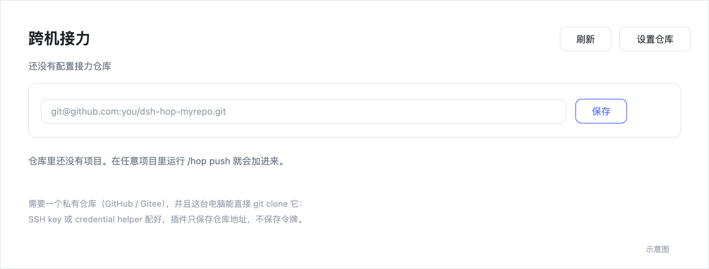
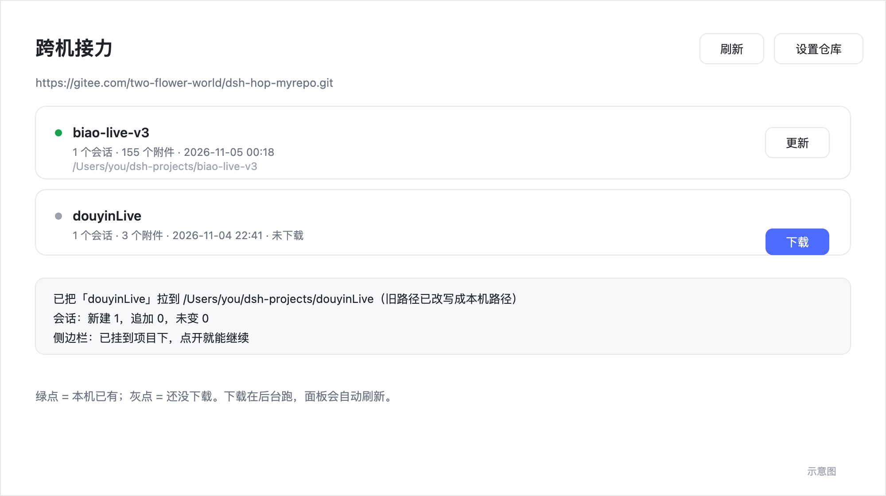

# dsh-plugin-hop · Cross-machine Relay


English | [中文](README.md)

One private repository holds every project. `/hop push` on the work machine, one click on **Download** at home — sessions, todos, attachments and code travel together, and the conversation continues without re-briefing the model.

## What it solves

A DSH session is an **event log**: every turn, tool call, todo list (`todo_write`), goal and compaction summary lives in it. Move that log to another machine and re-attach it to the same project, and the model's context is complete — not a summary, the real thing.

| Content | Channel | Notes |
|---|---|---|
| Sessions, todos, goals, attachments | A private relay repository | Exported and imported by the plugin |
| Project code | The project's own git | Snapshot commit on `hop/<device>` |

## Install

1. `git clone <this repository>` anywhere.
2. Install it in DSH: `plugin_manager` → `install_bundle` → that directory.
3. Reload the page (⌘R); a **Relay** icon appears in the sidebar.

## Setup

### 1. Create a private repository

Create a **private** repository on GitHub or Gitee for relay state only, not project code. For example `dsh-hop-myrepo`.

### 2. Let this machine access it

If this machine already has git credentials configured (`git ls-remote <repo-url>` works without prompting), skip this step.

**SSH**

```bash
ssh-keygen -t ed25519 -C "you@example.com"   # skip if a key already exists
cat ~/.ssh/id_ed25519.pub
```

Add the public key on the platform:

- GitHub: Settings → SSH and GPG keys → New SSH key
- Gitee: Settings → SSH keys

Verify:

```bash
ssh -T git@github.com     # or git@gitee.com
```

> A welcome message or `successfully authenticated` means it works; `Permission denied` means the key was not added correctly.

**HTTPS with a token**

```bash
# macOS
git config --global credential.helper osxkeychain
# Windows
git config --global credential.helper manager
# Linux
git config --global credential.helper libsecret

printf 'protocol=https\nhost=github.com\nusername=<account>\npassword=<token>\n\n' | git credential approve
```

For Gitee use `host=gitee.com`. Create the token in the platform settings: GitHub needs `repo` scope, Gitee needs `projects`.

Verify:

```bash
git ls-remote <repo-url>
```

Refs printed and no error means this machine can reach the repository.

### 3. Enter it in the plugin

Click **Set repository** in the panel, or run:

```
/hop setup <repo-url>
```

Saving clones once to verify. Authentication errors surface as git's own message (usually 401 / 403 / `Permission denied`) — fix step 2 and retry.

Every project on this machine then shares that relay — no per-project setup.

## Interface

Where the icon lives:


First run: enter the repository URL.



After that it is a project list — click **Download**:



> Illustrations; the real UI follows the active light/dark theme.

## Usage

**Panel**: sidebar → **Relay** → the project list (green dot = present here, grey dot = not downloaded) → **Download**. Pulls run in the background; the panel polls progress and refreshes when done.

**Commands**:

```
/hop              list projects in the relay
/hop push [note]  hand the current project off
/hop pull name    download it on this machine
/hop status       show this machine's settings
```

With a single project in the relay, `/hop pull` needs no argument. The default destination is `~/dsh-projects/<name>`.

**Tools**: `hop_setup`, `hop_push`, `hop_pull`, `hop_list`, `hop_status` — or just say "hand this project off to the other computer".

**Sub-sessions**: push includes every subagent session spawned from the current one; pull rebuilds them parent-first.

**Closed sessions**: pass `session` to the tool, e.g. `hop_push({"session":"session-cca62e...","project":"biao-live-v3"})`.

## What is synced

```
relay repo
├── relay.json                         # project index: name, time, session count, source path
└── projects/<project-name>/
    ├── manifest.json                  # device, time, base commit, session/attachment list
    ├── sessions/<id>.json.zst         # session log (header + events, compressed JSONL)
    └── attachments/<sha256>.bin       # images/files referenced by events, content-addressed
```

Session bundles are compressed text (about 6MB for 157 turns); attachments are copied on demand; old absolute paths are rewritten to the new root on import.

## FAQ

**Code did not come along?** The project is not a git repository or has no `origin`; the plugin skips code sync and says so in its output.

**Paths differ?** Pass a destination to pull, or use the default `~/dsh-projects/<name>`; old paths in the log are rewritten.

**Project root vs. session working directory?** `--project` only affects code sync — session paths follow the **session's working directory**. Make the working directory the project directory when paths must align exactly.

**Model keys / plugins / skills missing?** They are **not synced**, and should not be. Configure each machine once; that is the only unavoidable setup step.

**Both machines edited the same session?** Relay means *handoff*, not real-time collaboration. A session still running locally is imported as a copy; divergent history creates a new session. Nothing is merged silently.

**Repository too large?** Long sessions with many screenshots reach hundreds of MB. Start fresh sessions periodically, or prune old projects.

**push fails with an auth error?** Every git command runs with `GIT_TERMINAL_PROMPT=0`, so it fails fast. Run `git ls-remote <repo-url>` once in a terminal to confirm the credentials work.

## Security

- Session logs can contain pasted secrets; the relay repository **must stay private**.
- Keep tokens out of repository URLs and chat logs; use a credential helper or SSH.
- Granting relay access grants the ability to read every conversation.

## Development

```
dsh-hop/
├── index.js          Host: commands, tools, JSON routes, git/session transfer
├── client.js         Panel: sidebar.panellist + main
├── cordis.patch.yml  plugin row
└── locale/           display names and descriptions
```

After changing host code, remove and reinstall the bundle so the new JavaScript loads; `client.js` changes only need a page reload.
